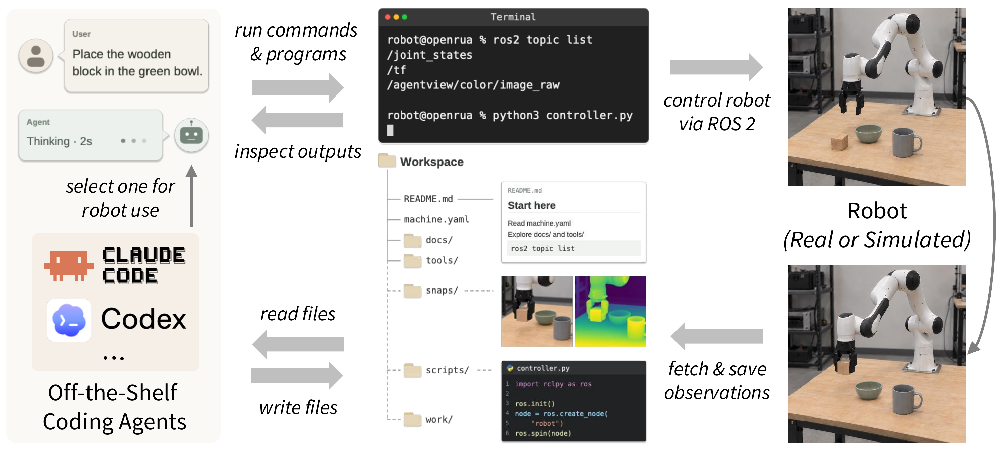

<div align="center">

# OpenRUA

**Let Your Claude Code or Codex Control Any Robot, Real or Simulated**

*Through the standard ROS&nbsp;2 CLI and client library, without relying on any VLA model.*

[](https://github.com/terminalworld/OpenRUA/actions/workflows/ci.yml)
[](https://arxiv.org/abs/2610.02459)
[](pyproject.toml)
[](docs/architecture.md)
[](LICENSE)<br>
[](https://github.com/terminalworld/OpenRUA/stargazers)
[](https://github.com/terminalworld/OpenRUA/forks)
[](https://github.com/terminalworld/OpenRUA/watchers)

https://github.com/user-attachments/assets/5da8fee1-4e49-4035-87b9-a768f8e7c3b2

*Watch Codex observe a simulated robot, write and run code, and save images, programs and notes in one coding project. [More demos](docs/demos.md).*

</div>

A [robot-use agent](https://web.mit.edu/phillipi/www/writing/robot-use-agents.html) (RUA)
uses a robot just as a computer-use agent uses a computer.

OpenRUA connects off-the-shelf coding agents to robots through their native
ROS&nbsp;2 interfaces. The agent works in a workspace containing robot
documentation and starter tools, writes perception and control programs, and
uses execution feedback to continue the task.

> **Turn your robot into a coding project.**
>
> Your agent explores the robot like a live codebase, pulls sensor streams
> into files for reading, and runs commands and programs to move it.
>
> *Start playing with your robot like you code a project :)*

## News

- **2026-10-24:** Robot setup, environment files and ongoing development now
  belong to the coding project for both real robots and simulation.
  ([v0.23.0](https://github.com/terminalworld/OpenRUA/releases/tag/v0.23.0))
- **2026-10-21:** Your coding agent can connect a real robot with you, preparing
  its drivers and checking the setup step by step.
  ([v0.13.0](https://github.com/terminalworld/OpenRUA/releases/tag/v0.13.0))
- **2026-10-01:** **The paper is out:** [OpenRUA: Robot-Use Agents Are Zero-Shot Visuomotor Policies](https://arxiv.org/abs/2610.02459).
- **2026-09-14:** OpenRUA is public. Give Claude Code or Codex a robot,
  simulated or real.
  ([v0.0.7](https://github.com/terminalworld/OpenRUA/releases/tag/v0.0.7))

[More project news](docs/news.md) · [All release changes](CHANGELOG.md)

## Quick start

On **Linux with Python 3.10 or newer**, run:

```sh
pip install -U openrua
mkdir my-robot-project
cd my-robot-project
openrua
```

Follow setup to choose a simulation environment and your coding agent.
OpenRUA guides Docker setup and agent sign-in when needed; the first
preparation can take a few minutes. Once the robot is ready, try:

> Look through the cameras and describe the scene, without moving the robot.

See [installation](docs/install.md) for requirements and authentication.

### Connect your own robot

In your project, run `openrua connect`. Your coding agent works with you to
identify the robot, prepare its ROS 2 drivers and save its setup in the project.
See [connect a real robot](docs/connect.md) for the walkthrough.

## Ways to work

| Workflow | Start with |
|---|---|
| [Terminal chat](docs/terminal.md) | `openrua` |
| [Browser chat](docs/sessions.md) | `openrua --gui` |
| [The agent's own terminal](examples/first-task.md#1a-the-agents-own-terminal) | `openrua agent` |
| [One recorded task](docs/projects.md#run-a-task-without-the-interactive-interface) | `openrua exec "<task>"` |

## Why OpenRUA

-  **Your coding agent, ready for robot work.** Use Claude Code or Codex with
  your account or API key. OpenRUA prepares the ROS 2 tools, simulators and
  configured drivers in containers, keeping their dependencies separate from
  your host setup.
-  **Work with the robot while your agent works.** Inspect camera images and
  tool activity, send a follow-up instruction, and stop an action from a shared
  conversation in the terminal or browser.
-  **Keep building on what you learn.** Programs, observations and notes stay
  in your project across conversations. Useful methods can become skills your
  agent reuses in later work, in simulation or on hardware.

## How it works

[](docs/media/paper-overview.pdf)

*Overview from our [paper](https://arxiv.org/abs/2610.02459). Click the figure for the original PDF.*

The agent decides when to observe, what program to write and how to check the
result. It works through the robot's native interfaces. See
[how the pieces fit together](docs/architecture.md).

## Supported agents

| Agent | Status |
|---|---|
| [Claude Code](https://claude.com/claude-code) | Supported (`--agent claude-code`) |
| [Codex](https://github.com/openai/codex) | Supported (`--agent codex`) |
| [Kimi Code](docs/agents/kimi.md) | Preview (`--agent kimi`) |
| [ZCode](docs/agents/zcode.md) | Preview (`--agent zcode`) |

Model and permission choices follow the selected agent. The preview guides
explain authentication and feature limits. You can also
[bring another coding agent](docs/agents.md).

## Supported robots

Start with a bundled simulation robot or connect your own ROS 2 hardware.
Robot setup, programs and observations belong to your coding project.

| Robot | Environment |
|---|---|
| Franka Emika Panda (`panda`) | robosuite, ManiSkill, CALVIN, VLABench |
| Panda on an Omron mobile base (`panda-omron`) | robosuite through RoboCasa and RoboCasa365 |
| Trossen WidowX 250S (`widowx`) | ManiSkill through SimplerEnv |
| AgileX Cobot Magic, two ARX X5 arms (`aloha-agilex`) | RoboTwin |
| **Your ROS 2 robot** | Your ROS 2 drivers; [connect](docs/connect.md) or [describe it yourself](docs/your-own-robot.md) |

## Simulation

<a id="supported-simulators"></a>

### Simulators

| Simulator | Engine | Robots |
|---|---|---|
| [robosuite](https://robosuite.ai) | MuJoCo | Panda; Panda-Omron through RoboCasa |
| [ManiSkill](https://maniskill.ai) | SAPIEN / PhysX | Panda, WidowX |
| [RoboTwin](https://robotwin-platform.github.io) | SAPIEN / PhysX | ALOHA-AgileX |
| [CALVIN](https://github.com/mees/calvin) | PyBullet | Panda |
| [VLABench](https://github.com/OpenMOSS/VLABench) | dm_control / MuJoCo | Panda |

The [environment catalog](docs/environments.md) covers native scenes, versions
and configuration choices. [Simulation setup](docs/simulation.md) covers
images and rendering.

### Benchmarks

Run community benchmark scenes with their original success predicates.
`openrua bench` runs task sets as isolated trials and keeps their scores,
agent transcripts and workspace files. `openrua exec` runs one task in your
coding project and records the run.

| Benchmark | Tasks | Simulator |
|---|---|---|
| [LIBERO](https://github.com/Lifelong-Robot-Learning/LIBERO) | Standard manipulation suites and LIBERO-90 | robosuite |
| [LIBERO-PRO](https://github.com/Zxy-MLlab/LIBERO-PRO) | Perturbed LIBERO tasks | robosuite |
| [LIBERO-Plus](https://github.com/sylvestf/LIBERO-plus) | Large-scale perturbations of LIBERO tasks | robosuite |
| [LIBERO-Mem](https://github.com/libero-mem/libero-mem) | Tasks requiring memory | robosuite |
| [RoboCerebra](https://github.com/qiuboxiang/RoboCerebra) | Long-horizon tabletop tasks | robosuite |
| [CaP-Bench](https://github.com/capgym/cap-x) | Tabletop manipulation | robosuite |
| [RoboCasa](https://robocasa.ai) | Kitchen tasks | robosuite |
| [RoboCasa365](https://robocasa.ai) | The 365-task kitchen benchmark | robosuite |
| [ManiSkill](https://maniskill.ai) | Eleven tabletop Panda tasks | ManiSkill |
| [SimplerEnv](https://simpler-env.github.io) | WidowX Bridge tasks | ManiSkill |
| [MIKASA-Robo](https://github.com/CognitiveAISystems/MIKASA-Robo) | Memory-conditioned tasks | ManiSkill |
| [RoboTwin 2.0](https://robotwin-platform.github.io) | Dual-arm manipulation, Easy protocol | RoboTwin |
| [CALVIN](https://github.com/mees/calvin) | Five-task sequences | CALVIN |
| [VLABench](https://github.com/OpenMOSS/VLABench) | Language-conditioned manipulation | VLABench |

[Run experiments and render demos](docs/running-experiments.md) ·
[Full benchmark details](docs/environments.md#supported-benchmarks) ·
[Paper results and model comparisons](docs/results.md)

## Documentation

- [Your first shared session](examples/shared-session.md): chat, cameras and the
  robot in one conversation.
- [Connect a real robot](docs/connect.md): prepare and maintain your robot setup.
- [Robot projects](docs/projects.md) and [skills](docs/skills.md): keep developing
  across conversations and reuse useful methods.
- [Terminal controls](docs/terminal.md): messages, history, files and session controls.
- [Extend OpenRUA](docs/agents.md) and [contribute](CONTRIBUTING.md): add agents
  and work on the package.

See the [full documentation index](docs/README.md) for all guides and references.

## Citation

If you use OpenRUA in your research, please cite our [paper](https://arxiv.org/abs/2610.02459):

```bibtex
@misc{chu2026openrua,
  title         = {{OpenRUA}: Robot-Use Agents Are Zero-Shot Visuomotor Policies},
  author        = {Zhaoyang Chu and Earl T. Barr and Claire Le Goues and Peter O'Hearn and Mark Harman and Federica Sarro and He Ye},
  year          = {2026},
  eprint        = {2610.02459},
  archivePrefix = {arXiv},
  primaryClass  = {cs.RO},
  url           = {https://arxiv.org/abs/2610.02459}
}
```

## License

[Apache-2.0](LICENSE)

## Feedback

Try OpenRUA with your coding agent and robot, and tell us how it goes.
Bug reports, confusing steps, and ideas for improving the experience are welcome
in [GitHub Issues](https://github.com/terminalworld/OpenRUA/issues).
If something fails, include your OpenRUA version, agent, environment, and the
command or steps that led to it. Please remove credentials and private data
from any logs you share.
